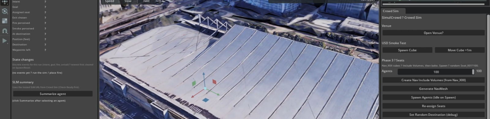
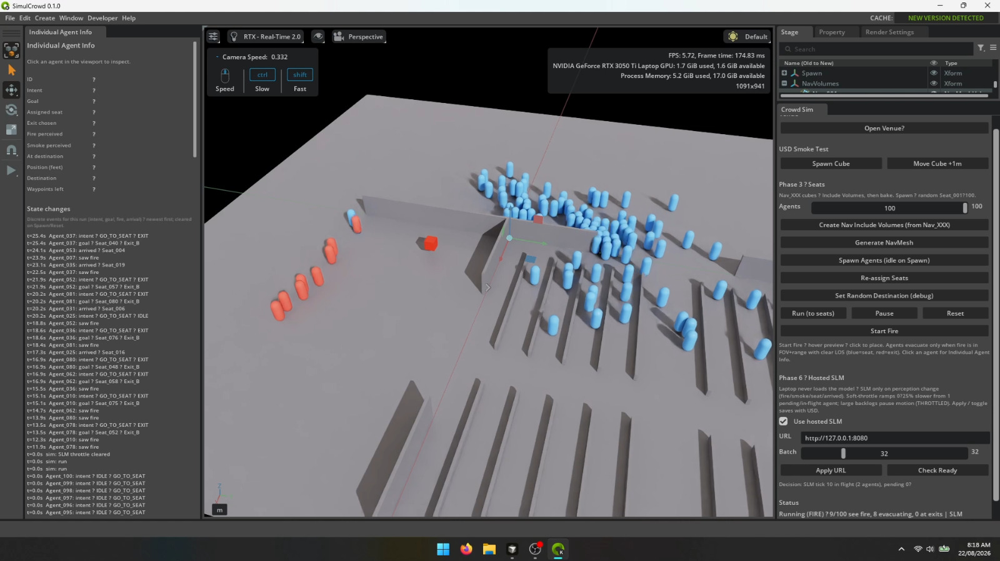

<p align="center">
  
</p>
<p align="center"><em>Load a real venue, spawn a crowd, and plan seating and exits in 3D.</em></p>

# SimulCrowd

SimulCrowd helps you **see how crowds of people move through a space** — seating,
corridors, exits — and how they react when something goes wrong. Load a real
venue layout, fill it with simulated people, and watch them find seats, react
to hazards, and evacuate.

Built on NVIDIA Omniverse / Kit.

## Use cases

| Use case | How SimulCrowd helps |
|----------|----------------------|
| **Emulating group behaviour** | Simulated people walk, choose goals, keep distance from each other, and react individually — not as one rigid mass. |
| **Building evacuation planning** | Place a fire or hazard and see who notices, which exits they choose, and where bottlenecks form. |
| **City / venue planning** | Test how seating, corridors, and exits shape flow before construction or renovation. |
| **Event layout planning** | Try alternative seating maps and exit arrangements for concerts, conferences, or stadiums. |
| **Crowd safety prediction** | Spot crowding, slow exits, and dead zones early — while you can still change the design. |

The goal is to answer questions like: *Will people reach seats smoothly? If
there is a fire, do they evacuate in time? Which layout is safer?*

## Monetization routes

SimulCrowd fits a **B2B subscription** model: organizations pay for ongoing access
to plan, simulate, and review crowd scenarios — not a one-off consumer app.

### Who would subscribe

| Customer | Why they pay |
|----------|--------------|
| **Venue operators** (stadiums, arenas, theatres, malls) | Test seating maps and exit plans before events and renovations |
| **Event organisers & promoters** | Compare layouts for concerts, conferences, and festivals; reduce bottlenecks |
| **Architects & urban / city planners** | Validate circulation and egress while the design can still change |
| **Fire / safety consultants & insurers** | Run evacuation scenarios and document predicted crowd risk |
| **Public agencies & emergency services** | Rehearse building and district evacuations without disrupting the real site |
| **Universities & training programmes** | Teach crowd dynamics and safety planning in a shared classroom environment |

### What the subscription is for

| Offering | What the customer gets |
|----------|------------------------|
| **Workspace seats** | Named users who can load venues, run sims, and share results with stakeholders |
| **Venue / project slots** | Stored layouts and scenarios (normal flow + fire/evac variants) per site |
| **Simulation capacity** | Larger crowds, more runs, and longer planning sessions under the plan |
| **Hosted AI decisions** | Cloud AI for per-person choices and agent summaries (usage or tier limits) |
| **Scenario packs** | Pre-built templates (arena seating, lobby egress, conference hall) |
| **Collaboration & export** | Shared reviews, status logs, and reports for clients or compliance |

### How packaging could look

- **Team** — small venues / planners: limited seats, a few venues, hosted AI
- **Professional** — event and safety firms: more projects, higher AI capacity,
  scenario packs
- **Enterprise** — operators and agencies: SSO, private cloud / on-prem AI, audit
  exports, training workshops

**Add-ons** (one-time or usage): custom venue import, on-site training, dedicated
GPU inference, white-label demos for client pitches.

<p align="center">
  
</p>
<p align="center"><em>During a fire scenario: who sees the hazard, who evacuates, and what each person is doing.</em></p>

## What you can do

- **Import a venue** — bring in a 3D layout of a hall, arena, or building floor
- **Fill it with people** — spawn dozens of agents who walk to assigned seats
- **Trigger a hazard** — place fire in the scene; only people who can see it
  start evacuating
- **Inspect anyone** — click a person to see what they are doing, where they
  are going, and what they have noticed
- **AI-driven decisions** — each person chooses whether to stay seated, go to
  a seat, or exit based on what they have seen

## How it works (in plain terms)

```text
  Your venue (3D layout)
           │
           ▼
  ┌────────────────────────────┐
  │  SimulCrowd (Omniverse)    │  ← people walk, see hazards, evacuate
  │  Crowd simulation + UI     │
  └─────────────┬──────────────┘
                │  ask AI what each person should do next
                ▼
  ┌────────────────────────────┐
  │  AI decision service       │  ← runs separately (laptop GPU or cloud)
  └────────────────────────────┘
```

1. **The 3D app** owns the venue, movement, vision (who can see fire/smoke),
   and the operator controls.
2. **Decisions** — sit / walk to seat / exit — come from a small language
   model that reasons about each person’s situation.
3. If the AI service is briefly offline, a rule engine keeps the simulation
   running so demos and planning sessions are not blocked.

Enable **Use hosted SLM** in the Crowd Sim panel to connect the AI service.
You do not need to understand the networking details to use the product.

## AI in SimulCrowd

AI drives per-person behaviour and supports the use cases above by giving each
simulated person a more human-like choice under pressure:

- **Per-person decisions** — go to seat, exit, or wait — based on what that
  person has seen (fire, smoke, exits, whether they reached their goal)
- **Natural-language summaries** — turn one agent’s live status into a short
  explanation an operator can read (useful in demos and reviews)
- **Scales with the crowd** — many agents can be decided together in batches;
  the 3D app stays responsive

Technical setup for the AI service lives in [`services/slm/README.md`](services/slm/README.md).

## Repository layout

| Path | Purpose |
|------|---------|
| `source/apps/crowd.sim.kit` | SimulCrowd application |
| `source/extensions/crowd.agents/` | Crowd simulation, UI, fire, AI client |
| `services/slm/` | AI decision / summary service |
| `images/` | README screenshots |
| `context/` | Connection and project notes |
| `templates/` | Upstream Omniverse templates |
| `tools/` | Build / repo tooling |

## Prerequisites

- **OS:** Windows 10/11 or Linux (Ubuntu 22.04+)
- **GPU:** NVIDIA RTX (3070 or better recommended)
- **Driver:** ≥550.54.15 (Linux) or ≥551.78 (Windows)
- **Git**, and the usual Kit SDK toolchain (see
  [Windows developer configuration](readme-assets/additional-docs/windows_developer_configuration.md)
  if building C++ on Windows)

The AI service can also run on Apple Silicon; the Omniverse app itself needs a
Windows or Linux NVIDIA machine.

## Quick start

### Build

**Linux:**
```bash
./repo.sh build
```

**Windows:**
```powershell
.\repo.bat build
```

### Launch

**Linux:**
```bash
./repo.sh launch
```

**Windows:**
```powershell
.\repo.bat launch
```

Select **SimulCrowd** / `crowd.sim`. First startup can take several minutes
while shaders compile.

### Typical planning session

In the Crowd Sim panel:

1. Start the AI service (see below), then enable **Use hosted SLM**
2. **Open Venue** → **Generate NavMesh** → **Spawn Agents**
3. Click a person to inspect them
4. **Run** — people walk to seats (normal event flow)
5. **Start Fire** — place a hazard and watch who evacuates and where

For custom venues, name seats, exits, and walkable areas consistently
(`Seat_001`…, `Exit_A` / `Exit_B`, spawn plane, nav volumes). Details are in
the extension docs linked below.

## AI service

Run the decision service before a planning session:

```bash
cd services/slm
# see services/slm/README.md for Mac or cloud GPU setup
```

LAN notes: `context/SLM_LAN_Connection.txt`.

## Extension docs

- [crowd.agents overview](source/extensions/crowd.agents/docs/Overview.md)
- [crowd.agents README](source/extensions/crowd.agents/docs/README.md)

## Governing terms

The software and materials are governed by the
[NVIDIA Software License Agreement](https://www.nvidia.com/en-us/agreements/enterprise-software/nvidia-software-license-agreement/)
and the
[Product-Specific Terms for NVIDIA Omniverse](https://www.nvidia.com/en-us/agreements/enterprise-software/product-specific-terms-for-omniverse/).

The Omniverse Kit SDK may collect anonymous usage data; see
[data collection details](readme-assets/additional-docs/data_collection_and_use.md).

## Additional resources

- [Usage and Troubleshooting](readme-assets/additional-docs/usage_and_troubleshooting.md)
- [Kit SDK Tooling Guide](readme-assets/additional-docs/kit_app_template_tooling_guide.md)
- [Omniverse Kit SDK Manual](https://docs.omniverse.nvidia.com/kit/docs/kit-manual/latest/index.html)
